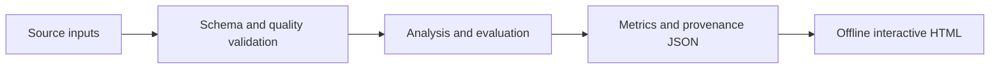

# Architecture and engineering decisions

**Project flow:** Trip CSV --> timestamp + duration validation --> calendar-aware aggregates --> paired-day uncertainty --> interactive comparison.

## Design decisions

### Compare behavior separately from group size
Subscriber trips dominate the source. Departure profiles therefore normalize inside each user/day-type group, while volume summaries retain the actual scale of each group.

### Define the uncertainty unit
The bootstrap resamples paired dates, keeping both categories together within a selected date. The estimand is the mean of daily median differences. It is not labelled as uncertainty in the pooled trip median.

### Explicit data treatment
Invalid timestamps, nonpositive durations, reversed trip times and unknown categories are excluded and counted. Exact duplicate input rows are audited but retained because the extract lacks a unique trip identifier. No demographic fields are needed for this analysis.

## Failure behavior

Schema errors, invalid analysis inputs and insufficient cohorts fail with an explicit command-line error and a nonzero exit status. Results serialize as strict JSON; non-finite values cannot silently enter the report. The HTML renderer escapes embedded JSON and writes chart labels as text. Reports make no external script, analytics or data requests.

## Source layout

- `src/mobility_customers/` contains the implementation and report renderer.
- `tests/` covers data/model invariants and report consistency.
- `docs/` contains a generated real-data report and its machine-readable results.
- `.github/workflows/ci.yml` runs checks on Python 3.11 and 3.12.

## Public artifacts

Raw restricted datasets are never embedded in the reports. Public outputs contain analytical aggregates and source fingerprints. Input filenames appear in the reproducibility record; local directories do not. Source/provider terms are documented separately in `DATA.md`.
