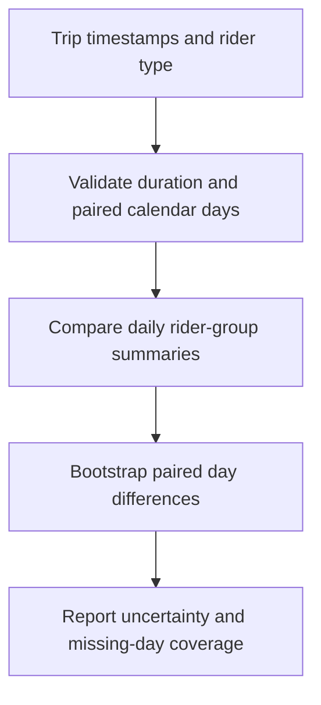
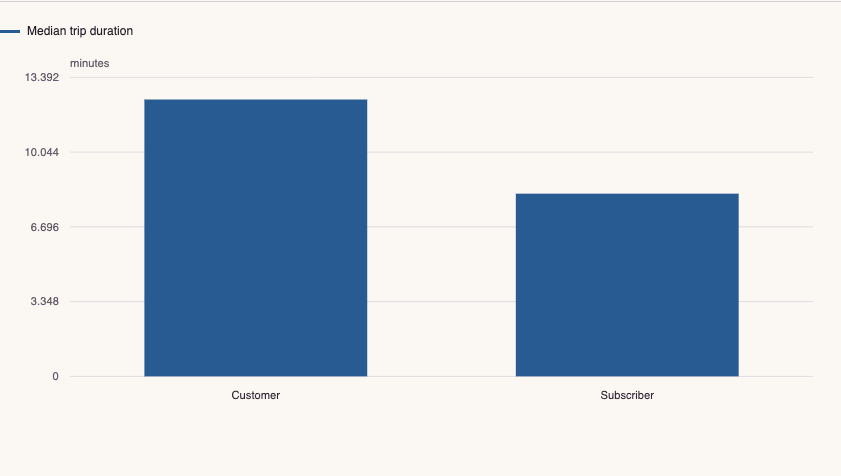

# Bike-Share Customer Behavior

Customer-segment analysis of 183,412 trips, with calendar-normalized demand profiles and a day-based uncertainty estimate.

**[Open the interactive report](https://feraselghandour.github.io/bikeshare-customer-behavior/)** · [Architecture](ARCHITECTURE.md) · [Methods and validation](VALIDATION.md)

[](https://github.com/FerasElghandour/bikeshare-customer-behavior/actions/workflows/ci.yml)

## How it works



## Try a small example

A small offline fixture exercises the public implementation. It demonstrates the behavior shown below; it does not replace the historical dataset, benchmark or production validation.

After the local setup below, run from the repository root:

```sh
python examples/quickstart.py
```

The [example source](examples/quickstart.py), [captured output](examples/expected-output.txt) and [execution record](examples/environment.json) keep this demonstration inspectable. Floating-point values may vary with library versions.

Observed output from this run:

```text
{
  "fixture": "six generated trips, not historical estimate",
  "audit": {
    "input_rows": 6,
    "valid_rows": 6,
    "excluded_invalid_rows": 0,
    "duplicate_input_rows": 0,
    "elapsed_difference_max_abs_sec": 0.0
  },
  "gap": {
    "available": true,
    "paired_days": 3,
    "estimate_minutes": 10.0,
    "ci95_minutes": [
      10.0,
      10.0
    ],
    "draws": 100,
    "seed": 42,
    "estimand": "Mean daily customer median minus mean daily subscriber median",
    "scope": "Day resampling does not remove serial dependence or identify unique riders."
  }
}
```

## What the evidence shows

Customer trips last longer across weekday and weekend contexts. Resampling paired dates gives a **5.06-minute mean daily median gap**, with a **95% percentile interval of 4.41–5.78 minutes**.

| Measure | Result |
|---|---|
| Valid trips | 183,412 |
| Subscriber share | 89.17% |
| Pooled median duration, customer / subscriber | 13.20 / 8.17 minutes |
| Customer median, weekday / weekend | 12.40 / 16.05 minutes |
| Day-resampled interval | 28 paired dates; 2,000 fixed-seed draws |

The interactive report includes selectable comparisons, a matching numerical table, CSV/JSON downloads and the reproducibility record. It also works offline: download `docs/index.html` and open it in a browser.

[](https://feraselghandour.github.io/bikeshare-customer-behavior/)

## Engineering

- A reusable trip validation and aggregation pipeline with an explicit exclusion audit.
- Calendar exposure includes zero-trip dates within the observed interval.
- Hourly profiles normalize within user/day groups, so the subscriber base does not dominate the comparison.
- Paired-date bootstrap estimates uncertainty for a precisely defined daily-median contrast.

The analysis is packaged under `src/mobility_customers/`; notebooks remain available for the longer exploratory narrative. Small root-level entry points preserve existing commands.

## Reproduce

Use Python 3.11 or later and a separate virtual environment for this repository.

```sh
python -m venv .venv
. .venv/bin/activate
python -m pip install -e ".[dev]"
python -m mobility_customers --input /path/to/201902-fordgobike-tripdata.csv --output reports
python -m pytest -q
```

Acquire the historical trip CSV through the source in [DATA.md](DATA.md). Raw trip records and demographic fields are not redistributed. The public demo embeds aggregate summaries only.

Each run writes `index.html` and `metrics.json` to the chosen output directory. The JSON records the measured results, input SHA-256 fingerprints, source-code fingerprints, dependency versions and analytical settings. To use the notebooks, install the optional `notebooks` dependencies.

## Interpretation

The daily contrast is the mean of customer daily medians minus the mean of subscriber daily medians. It is different from the pooled trip-median difference. Day resampling preserves within-day grouping but does not remove serial dependence. One month of trips does not identify unique customers or prove that membership causes longer or shorter rides.

## Portfolio

- [Weather-Aware Bike-Share Demand Analysis](https://github.com/FerasElghandour/bikeshare-weather-analysis)
- [Movie Revenue: Selection, Sensitivity & Uncertainty](https://github.com/FerasElghandour/movie-revenue-analysis)
- [Shared-Policy Continuous Control](https://github.com/FerasElghandour/tennis-reinforcement-learning)

---

**Feras Elghandour** · [GitHub](https://github.com/FerasElghandour)  
Data sources and applicable license notices: [DATA.md](DATA.md).
