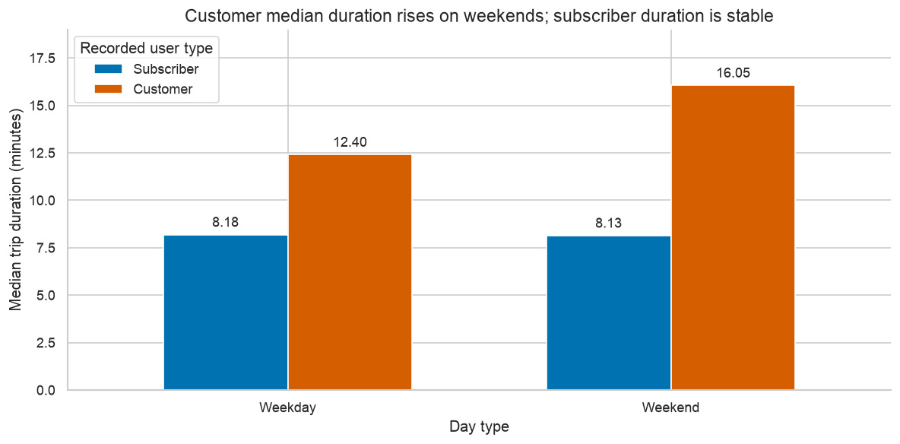

# Bike-Share Customer Behavior

Subscriber and occasional-customer trips place different demands on a bike-share network. This analysis examines 183,412 trips to compare how long bikes remain in use and when each group rides.

**Python · pandas · NumPy · Matplotlib · seaborn**



## Results

| Measure | Result |
|---|---|
| Trips analyzed | 183,412 |
| Subscriber share of trips | 89.17% |
| Median duration: customer / subscriber | 13.20 / 8.17 minutes |
| Customer median duration: weekday / weekend | 12.40 / 16.05 minutes |

## Implementation

- Prepared timestamps, duration units, ordered user groups and weekday/weekend categories.
- Compared pooled and subgroup medians to check whether aggregate patterns persist within day types.
- Normalized departure profiles within each user/day group and adjusted volume comparisons for calendar exposure.
- Developed exploratory analysis and a focused four-chart presentation using consistent labels, colors and comparison scales.

## Practical relevance

Demonstrates customer segmentation, operational analytics and the translation of exploratory findings into a concise decision-oriented presentation. Longer customer trips and shared weekday peaks provide starting points for station-level capacity investigations.

## Explore the project

- `Part_I_exploration.ipynb` — preparation, exploratory charts and sensitivity to subgroup definitions.
- `Part_II_explanatory.ipynb` — four presentation charts and their implications.
- `DATA.md` — input acquisition and source details.

## Run locally

```sh
python -m venv .venv
. .venv/bin/activate
python -m pip install -r requirements.txt
jupyter lab
```

Supply `201902-fordgobike-tripdata.csv` as described in `DATA.md`. Run `Part_I_exploration.ipynb`, followed by `Part_II_explanatory.ipynb`, from the repository root.

See [DATA.md](DATA.md) for required inputs and [VALIDATION.md](VALIDATION.md) for the checks and runtime versions.

## Scope

Records cover February 2019 in the San Francisco Bay Area. Rows represent trips, not unique riders. Station endpoint separation is not actual route distance, and the analysis does not establish why the groups differ.

---

**Feras Elghandour** · [GitHub](https://github.com/FerasElghandour)  
[Attribution and development notes](ATTRIBUTION.md)
